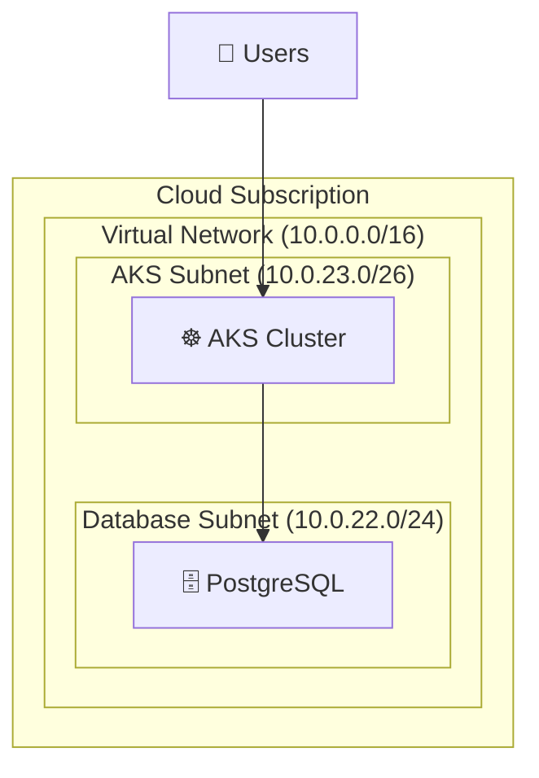

# IaC architecture diagram

Analyse the **folder the user names, otherwise the repository** and produce a Mermaid `flowchart TB` of the target architecture, plus a markdown write-up. The only file you create is the output file below.

## Analyse

1. **Discover**: Terragrunt layers (`terragrunt.hcl`), Terraform modules (`.tf` directories), environment separation (dev / qa / prod…).
2. **Read in this order**: `root.hcl` (project settings, locations), `_settings.hcl` / `_settings.tf` (versions, providers, backend), `module.hcl` (module sources), `inputs.hcl` (layer config, CIDR ranges), `terragrunt.hcl` (dependencies, includes), then the `.tf` files.
3. **Extract**:
   - network: VNets / VPCs with CIDR, subnets, gateways, private DNS, load balancers;
   - compute: Kubernetes clusters, VMs, registries, serverless;
   - data: databases, storage, backups;
   - security and identity: key vaults, identities, bastions, private endpoints;
   - monitoring and governance: log workspaces, insights, budgets.
4. **Dependencies**: `dependency` blocks, cross-layer data sources, network connectivity, service-to-service flows.

## Diagram

- Top-level container = cloud subscription / account; then a shared/tooling layer, one subgraph per environment, network subgraphs titled with their CIDR, subnet subgraphs titled with theirs (application, database, bastion, private endpoints, gateway).
- Solid arrows for primary traffic or data flows. Include external actors (users, CI/CD, external services).
- Short emoji icons by service type (☸️ Kubernetes, 🖥️ VM, 🗄️ database, 💾 storage, 🔑 key vault, 🌐 internet, 📊 monitoring, 🔐 identity).

## Output

Validate the Mermaid syntax if a validator is available. Save one markdown file with a clear name (suggested: `docs/diagrams/<folder-name>-architecture.md`) containing: the diagram, an architecture overview, resource organisation per layer, network architecture (CIDR allocation, subnet purposes, connectivity), component details (roles, dependencies, data flows), security architecture, and how it is deployed.

The diagram must reflect the IaC accurately, with CIDR ranges and dependencies shown and a readable layout. Take values from the code, never invent them; mark anything you could not determine.
