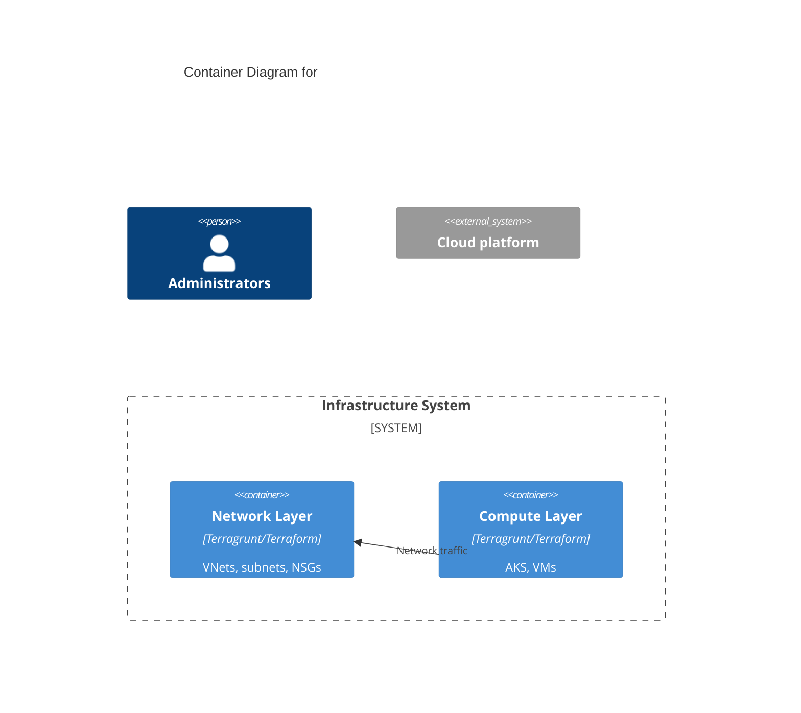

# C4 diagrams for Terragrunt IaC

Generate a C4 Level 1 (Context) and Level 2 (Container) diagram, in Mermaid, for the **folder the user names, otherwise the repository**. The only files you create are the two diagram files below.

## Analyse

1. **Structure**: layers are directories with a `terragrunt.hcl`; read `root.hcl`, `module.hcl`, `inputs.hcl`, `_settings.hcl` / `_settings.tf` and the `.tf` files. Map folders to logical components.
2. **Dependencies**: `dependency` blocks, `include` relationships, module `source`s, cross-layer data sources and remote state, input/output chains.
3. **Components**: cloud resource types (provider resources), external systems and user groups, network boundaries (VNets, subnets, firewalls), data stores, compute, security (key vaults, identities, RBAC).

## Diagrams

- **Level 1 (`C4Context`)**: users and admins, the system boundary, external systems (cloud platform, third parties), the main flows.
- **Level 2 (`C4Container`)**: Terragrunt layers grouped into containers by responsibility (networking, compute, data, security, monitoring), with technology, dependencies and data flows.

Skeleton:

## Output

Create `docs/diagrams/` if missing, then `docs/diagrams/<folder-name>-context.md` and `docs/diagrams/<folder-name>-container.md`. Each has a short header, the Mermaid block, and a few lines on the decisions shown. If a Mermaid validator is available, validate both diagrams.

Keep them readable: descriptive container names tied to business capabilities, technology in descriptions, protocols in relationship labels, security and network boundaries visible, not overcrowded. Finish with a brief summary of the architectural decisions and dependencies you found.
